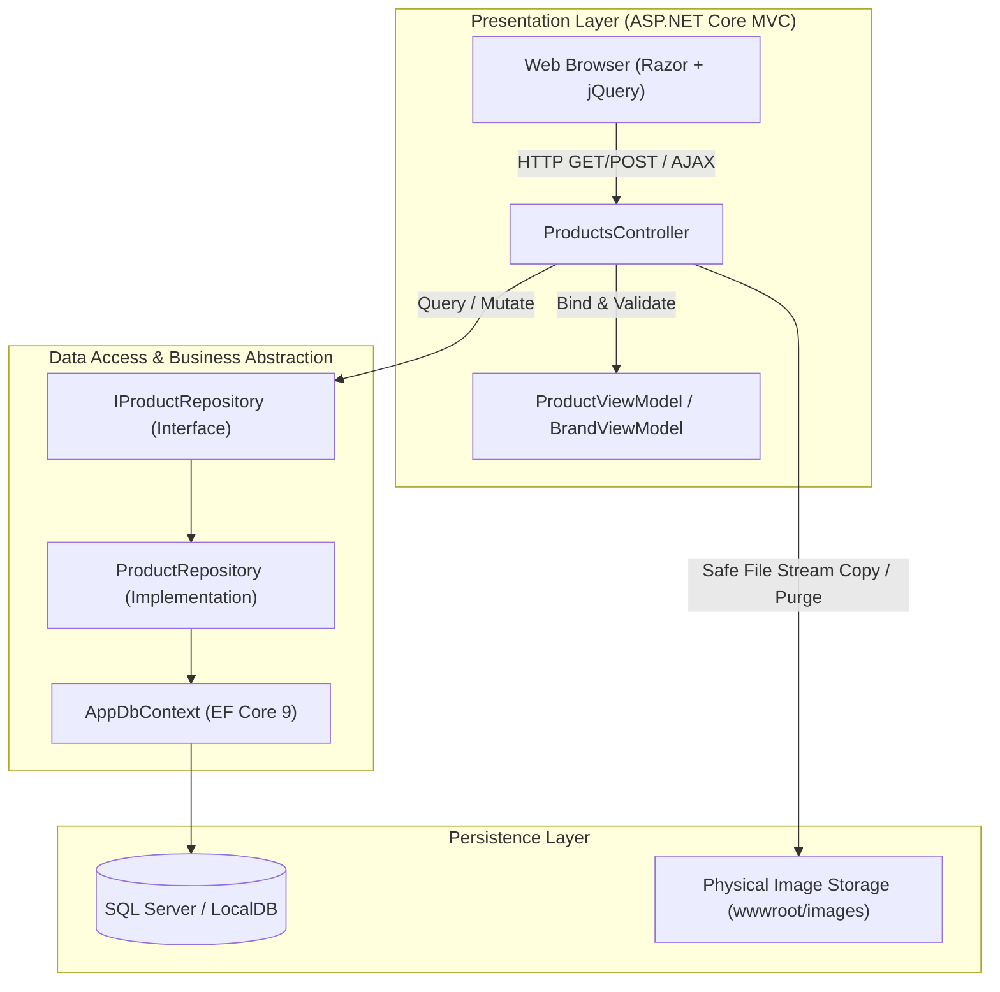
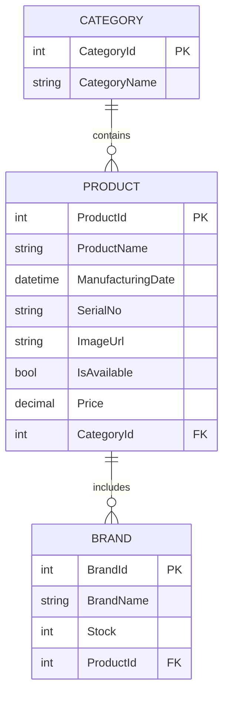

# ASP.NET Core 9 MVC — Dynamic Master-Detail Product Catalog

[](https://dotnet.microsoft.com/)
[](https://dotnet.microsoft.com/apps/aspnet)
[](https://www.nuget.org/packages/Microsoft.EntityFrameworkCore)
[](https://xunit.net/)
[](LICENSE)

An enterprise-ready **ASP.NET Core 9 MVC** application implementing an interactive master-detail product catalog with dynamic relational brand child rows, repository abstraction pattern, view model segregation, secure file upload pipelines, and a suite of 17 automated xUnit tests.

Developed by **A.H.M. Zafir Hasan** as part of the **IsDB-BISEW IT Scholarship Programme** (Enterprise .NET Track - Module 8).

---

## 🏛 Architecture Overview

The system strictly enforces the **Model-View-Controller (MVC)** architectural pattern alongside the **Repository Design Pattern**, decoupling presentation logic and HTTP concerns from data persistence.



---

## 🌟 Key Engineering Features

### 1. Master-Detail Dynamic Collection Management
- Supports multi-tiered parent-child entities: **1 Category ➔ Many Products ➔ Many Brands**.
- Dynamic child row additions and removals directly in the browser via lightweight jQuery/AJAX partial views (`_brands.cshtml`).
- Synchronized relational persistence: updates child records atomically without orphan leakages using `DeleteBrandByProductIdAsync` and `AddBrandByProductIdAsync`.

### 2. Repository Pattern & Clean Abstraction
- `IProductRepository` abstracts all Entity Framework Core queries.
- Controllers remain fully testable without direct coupling to `AppDbContext` or physical database engines.

### 3. Strict ViewModel Segregation & Anti-Overposting
- `ProductViewModel` and `BrandViewModel` separate external request structures from internal database entities.
- Prevents overposting attacks and provides dedicated validation annotations (`[Required]`, `[DataType(DataType.Date)]`, `[Display(Name = ...)]`).

### 4. Hardened Image Upload Pipeline
- Whitelisted image extension verification (`.jpg`, `.jpeg`, `.png`, `.gif`, `.webp`).
- Unique GUID naming scheme (`Guid.NewGuid().ToString() + extension`) mitigating path traversal and collision vulnerabilities.
- Automated cleanup: orphaned files are physically removed from disk when products are updated or deleted.

---

## 🗄 Database Relational Schema



---

## 📁 Project Structure

```
AspNetCore-ProductCatalog-MVC/
├── AspNetCore_ProductCatalog_MVC/          # Core ASP.NET Core 9 MVC Web Application
│   ├── Controllers/
│   │   ├── HomeController.cs              # Landing page controller
│   │   └── ProductsController.cs          # Master-detail CRUD & upload coordinator
│   ├── Models/
│   │   ├── AppDbContext.cs                # EF Core 9 DbContext with seed data
│   │   ├── Product.cs                     # Product domain entity
│   │   └── ViewModels/
│   │       ├── BrandViewModel.cs          # Child brand transfer model
│   │       └── ProductViewModel.cs        # Master product form model
│   ├── Repositories/
│   │   ├── IProductRepository.cs          # Data access contract
│   │   └── ProductRepository.cs           # EF Core async repository implementation
│   ├── Migrations/                        # EF Core Code-First migrations
│   ├── Views/
│   │   ├── Products/                      # Razor views (Index, Create, Edit)
│   │   └── Shared/
│   │       ├── _Layout.cshtml             # Master navigation & theme
│   │       └── _brands.cshtml             # Partial view for dynamic brand row
│   ├── wwwroot/                           # Static assets (Bootstrap, jQuery, images)
│   └── Program.cs                         # IoC container registration & HTTP pipeline
├── AspNetCore_ProductCatalog_MVC.Tests/    # Automated xUnit Test Suite
│   ├── ProductRepositoryTests.cs          # EF Core In-Memory repository tests (9 tests)
│   └── ProductsControllerTests.cs         # Moq-based controller unit tests (8 tests)
└── AspNetCore_ProductCatalog_MVC.sln      # Unified Visual Studio Solution
```

---

## 🧪 Automated Test Suite (17 Tests)

Comprehensive test coverage built with **xUnit**, **Moq**, and **Microsoft.EntityFrameworkCore.InMemory**:

```
Passed!  - Failed: 0, Passed: 17, Skipped: 0, Total: 17, Duration: 1 s
```

| Test Fixture | Test Scenario | Verification Type |
|---|---|---|
| `ProductRepositoryTests` | `GetAllProductAsync_ReturnsProductsWithCategoriesAndBrands` | Eager Loading (`Include`) |
| `ProductRepositoryTests` | `GetProductByIdAsync_ReturnsProduct_WhenExists` | Primary Key Lookup |
| `ProductRepositoryTests` | `GetProductByIdAsync_ReturnsNull_WhenNotExists` | Null Handling |
| `ProductRepositoryTests` | `SaveProductAsync_PersistsNewProduct` | Entity Persistence |
| `ProductRepositoryTests` | `UpdateProductAsync_ModifiesFields` | State Modification |
| `ProductRepositoryTests` | `DeleteProductAsync_RemovesProduct` | Entity Removal |
| `ProductRepositoryTests` | `AddBrandByProductIdAsync_AssociatesBrandsWithParentProduct` | Relational Foreign Key Binding |
| `ProductRepositoryTests` | `DeleteBrandByProductIdAsync_DeletesOnlySpecificParentBrands` | Targeted Child Range Removal |
| `ProductRepositoryTests` | `GetAllCategoriesAsync_ReturnsCategories` | Taxonomy Query |
| `ProductsControllerTests` | `Index_ReturnsViewResult_WithListOfProducts` | MVC ViewResult Model Binding |
| `ProductsControllerTests` | `Create_Get_ReturnsView_WithCategories` | View Model Population |
| `ProductsControllerTests` | `Create_Post_ValidModel_SavesProductAndReturnsJsonSuccess` | JSON Response & Repo Delegation |
| `ProductsControllerTests` | `Create_Post_InvalidModelState_ReturnsJsonFailure` | Validation Guard & Short-Circuit |
| `ProductsControllerTests` | `Edit_Get_NonExistentProduct_ReturnsNotFound` | 404 Guard |
| `ProductsControllerTests` | `Edit_Get_ExistingProduct_ReturnsViewWithProductViewModel` | Entity-to-ViewModel Mapping |
| `ProductsControllerTests` | `Delete_Post_ExistingProduct_DeletesAndRedirects` | RedirectToAction & Deletion Call |
| `ProductsControllerTests` | `Delete_Post_NonExistentProduct_ReturnsNotFound` | 404 Guard |

---

## 🚀 Getting Started

### Prerequisites
- [.NET 9.0 SDK](https://dotnet.microsoft.com/download/dotnet/9.0)
- SQL Server (LocalDB, Express, or Developer Edition)

### 1. Clone & Build
```bash
git clone https://github.com/Zafff-e/AspNetCore-ProductCatalog-MVC.git
cd AspNetCore-ProductCatalog-MVC
dotnet restore
dotnet build
```

### 2. Run Database Migrations
```bash
dotnet ef database update --project AspNetCore_ProductCatalog_MVC
```

### 3. Run Automated Tests
```bash
dotnet test
```

### 4. Run the Web Application
```bash
dotnet run --project AspNetCore_ProductCatalog_MVC
```
Navigate to `http://localhost:5000` or the HTTPS port displayed in console output.

---

## 👤 Author & Academic Background

- **Candidate:** A.H.M. Zafir Hasan
- **Scholarship:** IsDB-BISEW IT Scholarship Programme (Round 62 / Enterprise Systems)
- **GitHub:** [@Zafff-e](https://github.com/Zafff-e)
